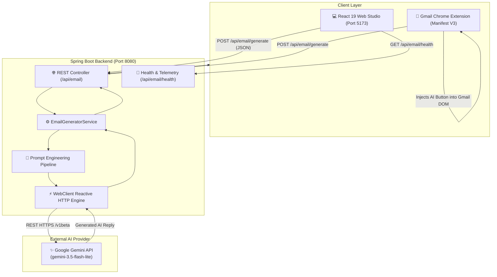

# 📬 MailCraft AI — Intelligent Email Reply Assistant

[](https://openjdk.org/)
[](https://spring.io/projects/spring-boot)
[](https://react.dev/)
[](https://vitejs.dev/)
[](https://mui.com/)
[](https://ai.google.dev/)
[](https://developer.chrome.com/docs/extensions/)
[](LICENSE)

An enterprise-ready, full-stack AI email reply ecosystem designed to eliminate inbox fatigue. **MailCraft AI** couples a high-performance **Spring Boot** reactive backend, a modern **React 19 + Material-UI** web studio, and a seamless **Gmail Chrome Extension (Manifest V3)** powered by Google's latest **Gemini 3.5 Flash Lite** model.

---

## 🏛️ System Architecture



---

## ✨ Key Features

* **🎭 Context-Aware Tone Control:** Switch communication styles seamlessly between:
  * 💼 **Professional:** Executive, formal, and structured.
  * ☕ **Casual:** Warm, relaxed, and approachable.
  * 🤝 **Friendly:** Enthusiastic, kind, and empathetic.
  * ⚡ **Concise:** Crisp, bullet-pointed, and direct.
  * 🎯 **Persuasive:** Compelling with clear calls-to-action.
  * 🙏 **Apologetic:** Sincere, constructive, and solution-oriented.
* **📏 Granular Length Selection:** Choose between *Concise*, *Balanced*, or *Comprehensive*.
* **✏️ Inline Editor Studio:** Edit generated replies directly within the card before copying.
* **⚡ 1-Click Clipboard Copy:** Animated copy button with instant toast feedback.
* **🔄 Quick Refinement Prompts:** Instant refinement chips (*Make Shorter*, *More Formal*, *Add Gratitude*, *Request Call*).
* **📚 Local Draft History:** Automatically saves the last 20 generated drafts in browser storage.
* **🔌 Real-Time Telemetry:** Live navbar health badge detecting backend connectivity and API key status.
* **📬 Gmail Chrome Extension:** Automatically detects open compose windows in Gmail and injects an AI reply button directly into your toolbar.
* **🛡️ Fail-Safe Fallbacks:** Comprehensive error handling preventing raw HTTP 500 server crashes with client-side API key configuration support.

---

## 🛠️ Tech Stack

| Category | Technology | Version | Purpose |
| :--- | :--- | :--- | :--- |
| **Backend Framework** | Spring Boot | 4.0.9 | High-throughput REST API & reactive web client |
| **Backend Language** | Java (JDK) | 17 LTS | Core server implementation |
| **Build Tool (Backend)** | Apache Maven | 3.10.x | Dependency management and packaging |
| **HTTP Client** | Spring WebFlux (`WebClient`) | 7.0.x | Non-blocking communication with Google Gemini |
| **Frontend Framework** | React | 19.3.x | Modern reactive component architecture |
| **Build Tool (Frontend)** | Vite | 8.3.x | Ultra-fast bundling, HMR, and build pipeline |
| **UI Component Library** | Material UI (MUI) | 9.5.x | Accessible, modern enterprise design system |
| **Icons & Styling** | Emotion + SvgIcon | 11.14.x | Lightweight SVG icon system and theme engine |
| **Browser Extension** | Chrome Extensions API | Manifest V3 | DOM Observer & content script for Gmail integration |
| **LLM Provider** | Google Gemini | 3.5 Flash Lite | State-of-the-art low-latency language model |

---

## 📂 Repository Structure

```text
Email-writer/
├── Email-Writer-SB/                     # Spring Boot Backend Service
│   ├── src/
│   │   ├── main/
│   │   │   ├── java/com/email/writer/
│   │   │   │   ├── EmailWriterApplication.java      # Application entrypoint
│   │   │   │   ├── EmailGeneratorService.java       # Gemini API client & prompt builder
│   │   │   │   └── app/
│   │   │   │       ├── EmailGeneratorController.java # REST API endpoints
│   │   │   │       └── EmailRequest.java            # DTO payload model
│   │   │   └── resources/
│   │   │       └── application.properties           # Spring Boot configuration
│   │   └── test/                                    # Unit & integration tests
│   ├── mvnw / mvnw.cmd                              # Maven wrappers
│   └── pom.xml                                      # Maven dependencies & plugins
│
├── emali-writer-react/                  # React 19 Frontend Web Studio
│   ├── src/
│   │   ├── components/
│   │   │   ├── Navbar.jsx                           # Header with telemetry & theme toggle
│   │   │   ├── ToneSelector.jsx                     # Interactive tone pills
│   │   │   ├── SettingsModal.jsx                    # Client API key & backend URL modal
│   │   │   ├── HistoryDrawer.jsx                    # Saved drafts slide-over drawer
│   │   │   └── Icons.jsx                            # High-performance SVG icon components
│   │   ├── App.jsx                                  # Main dual-pane application layout
│   │   ├── index.css                                # Global styling & scrollbars
│   │   └── main.jsx                                 # React root mount
│   ├── index.html                                   # HTML5 shell with Google Fonts
│   ├── package.json                                 # NPM dependencies & scripts
│   └── vite.config.js                               # Vite bundler configuration
│
├── email-writer_ext/                    # Chrome Extension for Gmail
│   ├── manifest.json                                # Manifest V3 permissions & content script
│   ├── content.js                                   # Gmail DOM observer & button injection
│   └── content.css                                  # Extension styling
│
├── .env.example                                     # Environment variables template
├── .gitignore                                       # Root git exclusions
├── .gitattributes                                  # Line ending normalization
└── README.md                                        # Master documentation
```

---

## 🚀 Quick Start Guide

### 1. Prerequisites

Ensure you have the following installed on your machine:
* [Java Development Kit (JDK 17+)](https://www.oracle.com/java/technologies/downloads/#java17)
* [Node.js (v18+) & npm](https://nodejs.org/)
* [Apache Maven (v3.8+)](https://maven.apache.org/) (or use included `mvnw.cmd`)
* A free [Google Gemini API Key](https://aistudio.google.com/app/apikey)

---

### 2. Configure Environment

Copy `.env.example` to create your local `.env`:

```bash
cp .env.example .env
```

Set your Gemini API Key:

```env
GEMINI_URL=https://generativelanguage.googleapis.com/v1beta/models/gemini-3.5-flash-lite:generateContent?key=
GEMINI_KEY=your_gemini_api_key_here
PORT=8080
```

---

### 3. Run the Spring Boot Backend

Navigate to `Email-Writer-SB`:

```bash
cd Email-Writer-SB
```

Build the project:
```bash
mvn clean package -DskipTests
```

Run the application:
```bash
# Windows PowerShell
$env:GEMINI_KEY = "your_gemini_api_key_here"
java -jar target/Email-writer-0.0.1-SNAPSHOT.jar

# Linux / macOS
GEMINI_KEY="your_gemini_api_key_here" java -jar target/Email-writer-0.0.1-SNAPSHOT.jar
```

The backend server will start on **`http://localhost:8080`**.

---

### 4. Run the React Web Studio

Open a new terminal tab and navigate to `emali-writer-react`:

```bash
cd emali-writer-react
npm install
npm run dev
```

Open your browser at **`http://localhost:5173`**.

---

### 5. Install the Gmail Chrome Extension

1. Open Google Chrome and navigate to `chrome://extensions/`.
2. Turn on **Developer mode** in the upper-right corner.
3. Click **Load unpacked**.
4. Select the **`email-writer_ext`** folder in this repository.
5. Open [Gmail](https://mail.google.com/), open any email, and click **Reply** — you will see the **AI Reply** button appear in the compose toolbar.

---

## 📡 API Reference

### Health Check

Check service health and API key readiness:

```http
GET /api/email/health
```

**Response (`200 OK`):**
```json
{
  "status": "UP",
  "service": "Email Writer AI Backend",
  "apiKeyConfigured": true
}
```

---

### Generate Email Reply

Generate an AI-powered response:

```http
POST /api/email/generate
Content-Type: application/json
```

**Request Body:**
```json
{
  "emailContent": "Hi Team, can we schedule a call tomorrow at 3 PM to review the proposal?",
  "tone": "professional",
  "length": "concise",
  "additionalInstructions": "Confirm availability and suggest Google Meet",
  "apiKey": "optional_client_side_override_key"
}
```

**Response (`200 OK`):**
```text
Hi [Name],

Yes, 3 PM tomorrow works well for me. I will send over a Google Meet invite shortly.

Best regards,
[Your Name]
```

---

## 🔒 Security & Privacy

* **Zero Hardcoded Secrets:** No API keys are committed to Git. All secret variables are managed via environment variables or git-ignored local files (`.env`, `application-local.properties`).
* **Client-Side Key Option:** Users can supply an API key directly in the web UI Settings dialog, which is stored solely in their local browser `localStorage`.
* **CORS Configured:** Backend accepts requests from localhost origins with standard headers.

---

## 🤝 Contributing

Contributions are welcome! Please feel free to open a Pull Request or submit an issue:

1. Fork the Project
2. Create your Feature Branch (`git checkout -b feature/AmazingFeature`)
3. Commit your Changes (`git commit -m 'Add some AmazingFeature'`)
4. Push to the Branch (`git push origin feature/AmazingFeature`)
5. Open a Pull Request

---

## 📄 License

This project is licensed under the MIT License — see the [LICENSE](LICENSE) file for details.
