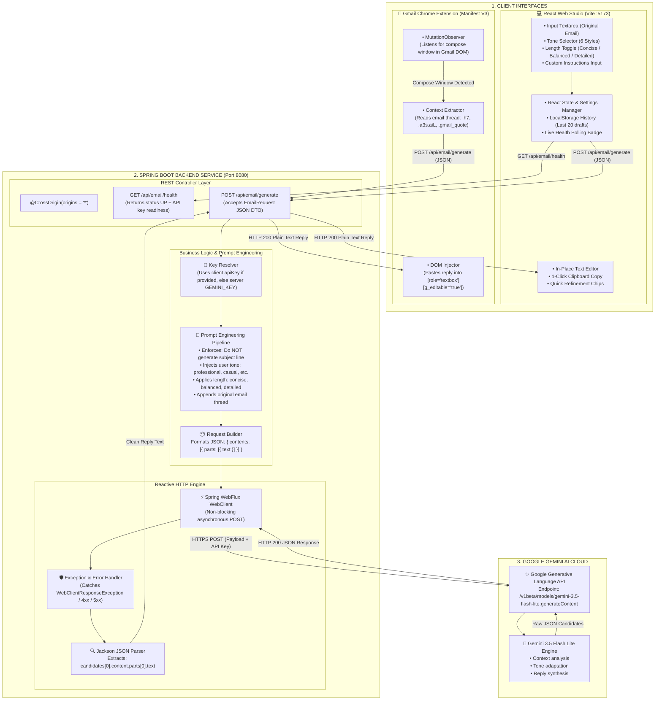
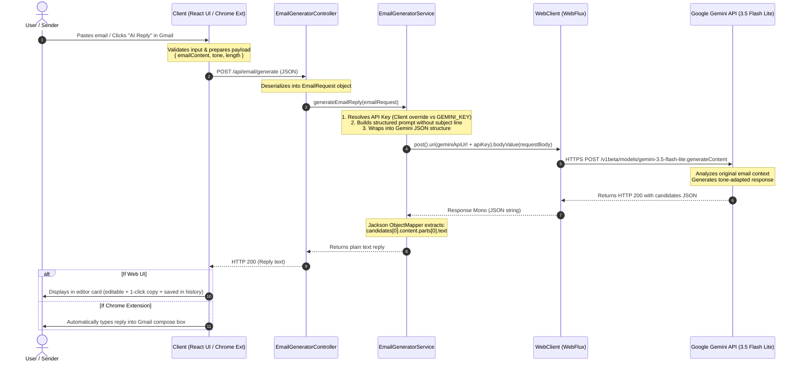

# AI Email Reply Generator (MailCraft)

A full-stack web application and Chrome extension that generates smart, context-aware email replies using Spring Boot, React, and Google's Gemini API.

I built this project to solve a simple everyday problem: writing repetitive emails and figuring out the right tone takes up too much time. This project combines a **Spring Boot backend**, a **React web interface**, and a **Chrome extension for Gmail** to generate quick email drafts in different tones (professional, casual, friendly, concise, etc.).

---

## System Architecture & Complete Workflow

Here is the detailed architectural breakdown and end-to-end data flow of the project.

### 1. High-Level Architecture Diagram



---

### 2. End-to-End Sequence & Data Flow Diagram

This sequence diagram illustrates the exact chronological step-by-step lifecycle of an email generation request:



---

### 3. Detailed Stage-by-Stage Workflow

| Stage | Process | Technical Details |
| :--- | :--- | :--- |
| **1. Trigger & Input** | The user inputs an email via either the **Web App** or directly in **Gmail**. | In Gmail, `content.js` uses a `MutationObserver` to watch the DOM for compose dialogs (`.btC`, `.aDh`). When found, it injects an "AI Reply" button. When clicked, it extracts the thread text from `.h7` or `.a3s.aiL`. |
| **2. API Ingestion** | The request is sent to the Spring Boot REST API. | Endpoint: `POST http://localhost:8080/api/email/generate`. Payload contains `{ emailContent, tone, length, additionalInstructions, apiKey }`. CORS is enabled via `@CrossOrigin(origins = "*")`. |
| **3. Prompt Engineering** | The backend structures the AI instructions. | `EmailGeneratorService` builds a prompt: ensures no subject line is created, appends tone rules (*Professional*, *Casual*, *Concise*, etc.), length rules (*Concise*, *Balanced*, *Detailed*), and the raw email text. |
| **4. Reactive WebClient Call** | Asynchronous HTTP request to Google Gemini API. | Uses Spring WebFlux `WebClient` to make an asynchronous call to Google's `gemini-3.5-flash-lite` model endpoint. |
| **5. Parsing & Error Guard** | Parses Gemini response and handles any failures gracefully. | Uses Jackson `ObjectMapper` to parse the `candidates[0].content.parts[0].text` path. If the key is invalid or quota is exceeded, clean diagnostic text is returned instead of crashing the server with a 500 error. |
| **6. Output Rendering** | Result is presented back to the user. | **React App:** Displays the response in an editable card with live word count, reading time, and 1-click clipboard copy. Saves draft to `localStorage`.<br/>**Chrome Extension:** Focuses Gmail's compose box and injects the text via `document.execCommand('insertText')`. |

---

## Tech Stack Used

### Backend
* **Java 17 (LTS):** Core programming language.
* **Spring Boot 4.0.9:** REST API framework, dependency injection, and server configuration.
* **Spring WebFlux (WebClient):** Non-blocking HTTP client used to call the Gemini API.
* **Jackson:** JSON serialization and deserialization.
* **Lombok:** Reduces boilerplate code (getters, setters, constructors).
* **Maven:** Dependency management and build tool.

### Frontend
* **React 19:** Component-based UI library.
* **Vite:** Fast development server and build bundler.
* **Material UI (MUI v9) & Emotion:** Clean UI components (Cards, Buttons, TextFields, Dark/Light theme).
* **Axios:** Handles HTTP requests to the backend.

### Chrome Extension
* **Manifest V3:** Modern Chrome extension standard.
* **Vanilla JavaScript:** DOM observer (`MutationObserver`) to detect Gmail compose windows and inject the AI button.
* **CSS:** Custom button styling matching Gmail's native UI.

### AI Engine
* **Google Gemini API (`gemini-3.5-flash-lite`):** Fast, low-latency LLM for email text generation.

---

## Project Structure

```text
Email-writer/
├── Email-Writer-SB/               # Spring Boot Backend
│   ├── src/main/java/com/email/writer/
│   │   ├── EmailWriterApplication.java      # Main entry point
│   │   ├── EmailGeneratorService.java       # Calls Gemini & parses output
│   │   └── app/
│   │       ├── EmailGeneratorController.java # Endpoints (/health, /generate)
│   │       └── EmailRequest.java            # Request DTO
│   ├── src/main/resources/
│   │   └── application.properties           # Server & API configuration
│   └── pom.xml                              # Maven dependencies
│
├── emali-writer-react/            # React Frontend
│   ├── src/
│   │   ├── components/
│   │   │   ├── Navbar.jsx                   # Top header with health check & theme toggle
│   │   │   ├── ToneSelector.jsx             # Tone chips (Professional, Casual, etc.)
│   │   │   ├── SettingsModal.jsx            # Configure API key & backend URL
│   │   │   ├── HistoryDrawer.jsx            # Drawer showing saved recent replies
│   │   │   └── Icons.jsx                    # SVG icon components
│   │   ├── App.jsx                          # Main application layout
│   │   ├── index.css                        # Global styling
│   │   └── main.jsx                         # React root entry
│   ├── package.json
│   └── vite.config.js
│
├── email-writer_ext/              # Chrome Extension for Gmail
│   ├── manifest.json                        # Extension manifest
│   ├── content.js                           # Gmail DOM injection script
│   └── content.css                          # Button styling
│
├── .env.example                             # Environment variables template
├── .gitignore                               # Git ignored files
└── README.md                                # Project documentation
```

---

## Features

* **Multiple Tone Options:** Professional, Casual, Friendly, Concise, Persuasive, and Apologetic.
* **Length Selection:** Short/Concise, Balanced, or Comprehensive reply.
* **Quick Templates:** 1-click test templates (Reschedule Meeting, Project Inquiry, Polite Decline, Job Offer).
* **In-place Editing:** Edit the generated reply right inside the card before copying.
* **1-Click Copy:** Copy button with instant toast notification.
* **Quick Refinement Chips:** Buttons like *Make Shorter*, *More Formal*, *Add Gratitude*, or *Request Call*.
* **Drafts History:** Saves recently generated replies in browser storage so you don't lose them.
* **Dark / Light Mode:** Built-in theme switcher.
* **Live Backend Health Status:** Green/Red connection pill in the navbar showing whether the Spring Boot server is online.
* **Safe API Key Setup:** You can set the Gemini key in the environment or directly in the app's Settings modal.

---

## How to Run This Project Locally

### Prerequisites
Make sure you have installed:
1. **JDK 17 or higher** (`java -version`)
2. **Node.js (v18+) & npm** (`node -v`)
3. **Maven** (`mvn -version`)
4. A free **Gemini API Key** from [Google AI Studio](https://aistudio.google.com/app/apikey).

---

### Step 1: Clone the Repository
```bash
git clone https://github.com/<your-username>/Email-writer.git
cd Email-writer
```

---

### Step 2: Run the Spring Boot Backend

1. Navigate to the backend folder:
   ```bash
   cd Email-Writer-SB
   ```
2. Build the project:
   ```bash
   mvn clean package -DskipTests
   ```
3. Set your Gemini API key and start the server:
   * **On Windows (PowerShell):**
     ```powershell
     $env:GEMINI_KEY = "YOUR_GEMINI_API_KEY"
     java -jar target/Email-writer-0.0.1-SNAPSHOT.jar
     ```
   * **On Linux / Mac:**
     ```bash
     GEMINI_KEY="YOUR_GEMINI_API_KEY" java -jar target/Email-writer-0.0.1-SNAPSHOT.jar
     ```
4. The backend will start on **`http://localhost:8080`**.  
   You can verify it by opening `http://localhost:8080/api/email/health` in your browser.

---

### Step 3: Run the React Frontend

1. Open a new terminal tab and go to the frontend directory:
   ```bash
   cd emali-writer-react
   ```
2. Install dependencies:
   ```bash
   npm install
   ```
3. Start the Vite development server:
   ```bash
   npm run dev
   ```
4. Open **`http://localhost:5173`** in your browser.

---

### Step 4: Install the Chrome Extension (Optional)

If you want to use it directly in Gmail:
1. Open Google Chrome and go to `chrome://extensions/`.
2. Turn on **Developer mode** (toggle in the top-right corner).
3. Click **Load unpacked** and select the `email-writer_ext` folder from this repo.
4. Go to [Gmail](https://mail.google.com/), open any email thread, and hit **Reply**.
5. You will see an **AI Reply** button added to the compose toolbar.

---

## API Endpoints

| Method | Endpoint | Description |
| :--- | :--- | :--- |
| `GET` | `/api/email/health` | Health check returning server status and whether API key is configured. |
| `POST` | `/api/email/generate` | Generates email reply based on content and tone. |

### Example Request Body
```json
{
  "emailContent": "Hi, can you send the updated project report by 4 PM?",
  "tone": "professional",
  "length": "concise"
}
```

### Example Response
```text
Hi [Name],

I am finalizing the updated project report now and will send it over before 4 PM.

Best regards,
[Your Name]
```

---

## What I Learned from Building This

* How to integrate Spring Boot with third-party AI APIs using non-blocking **Spring WebFlux `WebClient`**.
* Handling CORS between a Spring Boot API, a React frontend, and a browser extension.
* Writing Chrome content scripts with `MutationObserver` to interact with dynamically rendered Gmail elements.
* Designing a clean dual-pane UI in React using Material UI and managing dark/light mode state.
* Implementing fallback error handling so the app doesn't crash if an API key is missing or invalid.

---

## Future Improvements

* Add user accounts and cloud history storage (e.g., using Firebase or PostgreSQL).
* Add support for generating replies in multiple languages.
* Support file attachment summaries before replying.

---

## License

This project is licensed under the [MIT License](LICENSE).
